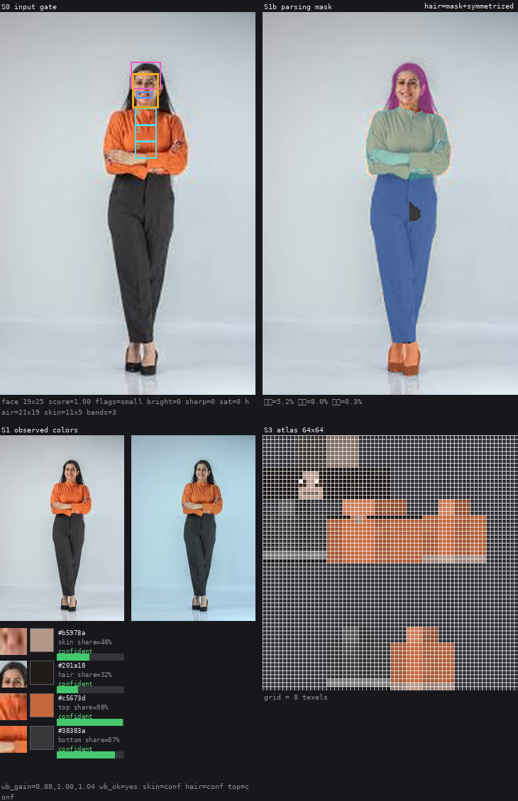

# skinmaker

인물 사진 → Minecraft 64×64 스킨 (RGBA PNG).

AI(VLM)는 사진에서 속성 JSON만 뽑습니다. 무엇을 입었는지(분류)와 무슨 색인지(색 추출)까지입니다. 픽셀은 전부 코드가 그립니다. 64×64 스킨에서 레이어당 칠할 수 있는 픽셀은 1,632개뿐이고 얼굴 앞면은 64픽셀입니다. 신경망 이미지를 옷칸(8×12)에 줄이면 색 얼룩이 되므로 AI의 몫을 분류와 색으로 제한했고, 렌더러가 하나뿐이라 이음새는 구조적으로 생기지 않습니다. 예외: 복잡 무늬(플로럴·플레이드·그래픽)는 사진에서 천 패치를 크롭·양자화해 채우고, 지퍼·단추·칼라·주머니 같은 구조는 1px 코드가 그 위에 그립니다.




한 사진의 처리 과정입니다. S0 입력 게이트 → S1b SCHP 파싱 마스크 → S1 관측 색 → S3 64×64 아틀라스.

**라이브:** https://skin.achijaser.date (공개 데모, 로그인 없음 — 민감한 사진은 올리지 마세요)

## 파이프라인

- S0 입력 게이트 (`quality.py`): YuNet 얼굴 검출과 품질 신호(밝기·흐림·크기). 유일한 거부는 얼굴 없음.
- S1 색 관측 (`colors.py`): 스킨 기준 화이트밸런스, 클러스터 대표색, 하의 캐스케이드.
- S1b SCHP 파싱 (`parsing.py`): 인체 파싱 마스크로 하의·머리·신발 색 위치를 확정. 기본 켜짐, 모델이 없으면 밴드 경로로 폴백.
- S2 분류 (`s2.py`, `attributes.py`, `classify.py`): VLM이 14필드(상·하의 enum, 무늬, 소매, 머리 길이/스타일, 후드, 수염, 안쪽 옷, 넥타이, 여밈, 칼라, 주머니, 대칭)와 `hair_bbox`를 채웁니다. 순서를 뒤집은 이중 질의가 어긋나면 불확실성으로 표시.
- S3 렌더 (`render.py`): 파라메트릭 텍스처, 하의 폴백 정책, 결정적 노이즈 시드.
- S4 후보 (`candidates.py`): 어긋난 필드만 변형해 1~3개 생성. 랭킹 없이 전부 검증을 통과해야 합니다.
- 웹: FastAPI + React 19 + three.js. 클래식(팔 4px)/슬림(팔 3px) 체형을 선택할 수 있습니다.

전송 계층(`vlm/`)은 mock, gemini, ollama, openrouter를 지원합니다.

## 저장소 구조

```
skinmaker/     코어 파이프라인 (S0~S4)
backend/       FastAPI 앱
frontend/      React + Vite + three.js
tests/         계약 테스트 + tests/fixtures (커밋된 소형 픽스처)
scripts/       fetch_assets.sh, dev_setup.sh 등 개발/운영 스크립트
docs/          설계 문서, 스크린샷, 디자인 목업, handover, ledger
assets/        YuNet 모델 (gitignored, fetch_assets.sh로 다운로드)
out/           로컬 산출물/사진/모델 (gitignored)
deploy/        systemd/Cloudflare Tunnel 배포 파일 (예정)
```

`out/`은 스크래치 공간입니다. 테스트에 필요한 사진은 `tests/fixtures/`에 있으므로 `out/` 없이도 전체 스위트가 돕니다.

## 설치 / 실행

```bash
python3 -m venv .venv
.venv/bin/pip install -r requirements-dev.txt
scripts/fetch_assets.sh                 # YuNet + SCHP (66MB)
.venv/bin/python -m pytest -q           # 623 테스트
.venv/bin/python -m skinmaker --model classic   # 더미 스킨 + 프리뷰 → out/
```

`python`이나 `uv`가 아니라 `.venv/bin/python`을 씁니다. 모델은 classic(팔 4px)과 slim(팔 3px)입니다.

### Windows

WSL2를 권장합니다. WSL2 안에서는 위 명령이 그대로 동작합니다. 네이티브 Windows에서는:

```powershell
py -3.12 -m venv .venv
.venv\Scripts\python.exe -m pip install -r requirements-dev.txt
# Git Bash에서:
bash scripts/fetch_assets.sh --yunet-only
.venv\Scripts\python.exe -m pytest -q
```

`.sh` 스크립트는 PowerShell/cmd가 아니라 Git Bash(또는 WSL2)에서 실행합니다. Gemini 키 없이 UI를 띄우려면 `.env`에 `SKINMAKER_TRANSPORT=mock`을 넣습니다. `scripts/deploy.sh`와 `cleanup_static.sh`는 Linux 호스트 전용이므로 Windows에서 실행하지 마세요. Windows용 `test-windows` CI job이 PR마다 테스트를 돌립니다.

`scripts/fetch_assets.sh --yunet-only`는 테스트/CI용(228KB)입니다. 테스트는 SCHP 모델 없이도 전부 돕니다(약 10초). SCHP 모델이 없으면 실제 파싱은 조용히 밴드 경로로 폴백합니다.

## 웹 (FastAPI + Vite)

```bash
cp .env.example .env && chmod 600 .env     # GEMINI_API_KEY 입력
.venv/bin/python -m uvicorn backend.app:app --host 127.0.0.1 --port 8001
cd frontend && npm install && npm run dev   # http://localhost:5173/
```

Vite 프록시가 8001을 바라봅니다. 포트를 바꾸려면 `VITE_API_TARGET=http://localhost:8002 npm run dev`와 `uvicorn --port 8002`를 함께 씁니다. `POST /api/v1/generate-skin`에 사진을 올리면 원본 옆에 후보 스킨을 3D 뷰어로 보여주고, 스킨 편집(투톤 신발), 분류 카테고리, 처리 과정 시트를 제공합니다.

백엔드는 `uvicorn`으로 실행할 때 저장소 루트의 `.env`를 자동으로 읽습니다. 이미 설정된 실제 환경변수가 우선하며, pytest 중에는 읽지 않습니다.

프로덕션에서는 `frontend`를 `npm run build`한 뒤 백엔드가 `frontend/dist`를 함께 서빙합니다. `dist`가 아직 없어도 서버는 뜨고, 빌드 후에는 재시작 없이 서빙됩니다. 배포는 홈 서버 + Cloudflare Tunnel(`skin.achijaser.date`)로 진행하며, 절차는 `docs/deployment.md`에 정리합니다. 공개 배포에는 업로드 15MB 제한, IP당 분당 6회 제한, 14일 보존이 걸려 있습니다.

## SCHP 파싱 (기본 켜짐)

```bash
scripts/fetch_assets.sh --schp-only
export SKINMAKER_PARSING=0   # 끄기 (밴드 전용으로)
export SKINMAKER_PARSER=out/models/schp-atr-18-int8-static.onnx   # 경로 지정
```

마스크가 있으면 Pants/Skirt 픽셀의 대표색이 하의 색이 되고, 머리·신발 색도 마스크에서 뽑습니다. 파일이나 의존성이 없으면 조용히 밴드 경로로 폴백합니다.

## CLI

```bash
.venv/bin/python -m skinmaker.samples <photo|folder>   # 단계별 컨택트 시트
.venv/bin/python -m skinmaker.measure <photos>         # S0 품질 분포
.venv/bin/python -m skinmaker.s2 --transport mock --photo <photo>
.venv/bin/python -m skinmaker.s4 --transport mock --photo <photo> --out out/s4
.venv/bin/python -m skinmaker.eval out/s0_photos --show 200
.venv/bin/python -m skinmaker.bottom_eval
```

## 개발 규범

- TDD(빨강 먼저). 실패를 먼저 보고 최소 구현으로 초록.
- 프론트 커밋 전 `cd frontend && npm run lint`.
- 정책·상수 변경은 기록된 A/B 근거가 필요합니다.
- 생성물(`out/`, `backend/static/`, `frontend/dist/`)과 `.env`, `*.onnx`는 커밋하지 않습니다.
- 두 에이전트가 함께 작업합니다. 브랜치/PR 규칙과 셋업은 [AGENTS.md](AGENTS.md)를 따릅니다.
- 두 번째 개발자(Codex)는 Tailscale로 접속하는 Docker devbox를 씁니다: [docs/devbox.md](docs/devbox.md).
- 3D 시각 QA: `.venv/bin/python -m skinmaker.qarender <skin.png>` — 카메라 계약·출력·옵션은 [docs/qa-render.md](docs/qa-render.md).
- PR마다 GitHub Actions가 `test`(pytest)와 `web`(lint + build)를 돌립니다. `master`는 PR + 1 approval + green checks를 요구합니다.

## CI

`.github/workflows/ci.yml` — `test`는 Python 3.12 + YuNet만 받아 623개 테스트를 돌리고, `web`은 Node 24에서 `npm ci`/lint/build를 돌립니다. 모델·사진·생성물은 캐시/다운로드 대상이며 저장소에 커밋하지 않습니다.

## 상태

S0~S4와 웹까지 동작합니다. 테스트 623개 통과. 얼굴 검출(YuNet)과 SCHP 모델은 저장소에 없고 `scripts/fetch_assets.sh`로 받습니다.

포즈 추정(`pose.py`)은 현재 비활성입니다. `mediapipe`와 포즈 모델이 빠져 있어 얼굴 비례 밴드로 폴백하며, 되살리려면 의존성과 `assets/pose_landmarker_lite.task`를 복구해야 합니다.

타인 사진에는 초상권 동의가 필요합니다. 공개 데모로 배포할 경우 민감한 사진을 올리지 마세요 — 업로드 파일은 서버에 저장되며 보존 기간 후 삭제됩니다.
