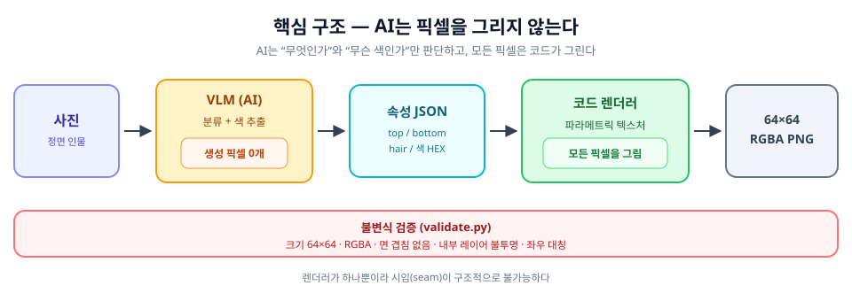
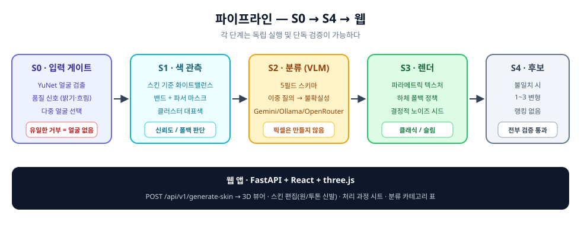
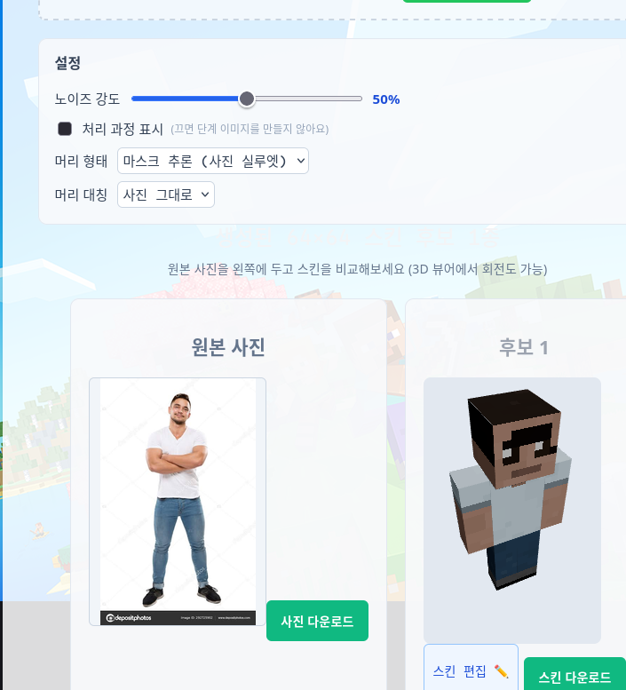
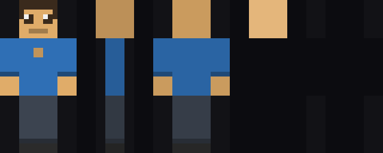
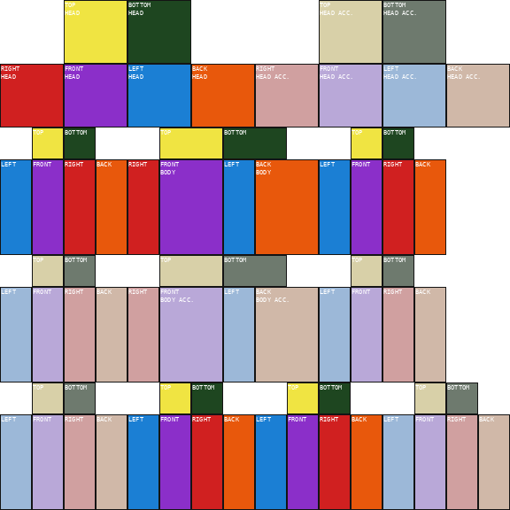

# skinmaker

인물 사진 한 장 → **Minecraft 64×64 스킨 (RGBA PNG)**.

핵심은 역할 분담이다. AI(VLM)는 사진에서 **속성 JSON**만 뽑고 — *무엇을 입었는가*(분류)와 *무슨 색인가*(색 추출) — **모든 픽셀은 코드가 그린다.**



**왜 이렇게 나눴나.** 64×64 스킨에서 레이어당 실제로 칠할 수 있는 픽셀은 1,632개, 얼굴 앞면은 64픽셀뿐이다. 정체성의 87%는 머리와 옷에 살고, 신경망 이미지를 8×12 옷칸에 억지로 줄이면 색 얼룩이 된다. 그래서 AI의 몫은 **분류와 색**까지로 제한한다. 렌더러가 하나뿐이라 이음새(seam)는 구조적으로 생길 수 없다.

- 기준이 되는 요구사항: *얼굴과 머리는 대충 비슷하면 된다.* 얼굴은 enum으로, 머리 실루엣은 자유 설계로, 색만 측정한다.
- 사진에서 실제로 관측되는 큐보이드 면은 14개 중 4개뿐. 관측할 수 없는 나머지 75%가 진짜 품질이 갈리는 곳이다.

## 파이프라인



| 단계 | 모듈 | 하는 일 |
|---|---|---|
| **S0** 입력 게이트 | `quality.py` | YuNet 얼굴 검출, 품질 신호(밝기·흐림·크기), 다중 얼굴 선택. **거부 조건은 “얼굴 없음” 하나뿐** |
| **S1** 색 관측 | `colors.py` | 스킨 기준 화이트밸런스, 밴드/파서 마스크 기반 대표색, 신뢰도·폴백 판단 |
| **S2** 분류 | `s2.py`, `classify.py` | VLM이 5필드 스키마(상·하의 enum, 소매 길이, 무늬, 기장) 채움. 이중 질의 불일치 = 불확실성 |
| **파서 마스크** | `parsing.py` | SCHP 인체 파싱으로 하의·머리·신발 색 위치 확정 (**기본 ON**, 없으면 밴드 경로로 폴백) |
| **S3** 렌더 | `render.py` | 파라메트릭 텍스처 그리기, 하의 폴백 정책, 결정적 노이즈 시드 |
| **S4** 후보 | `candidates.py` | 이중 질의가 어긋난 필드만 변형해 1~3개 생성. 랭킹 없음, 전부 검증 통과 필수 |

전송 계층(`vlm/`)은 `mock` · `gemini` · `ollama` · `openrouter`를 지원하며, OpenRouter는 무료 모델 폴백 체인을 쓴다.

## 설치 / 실행

```bash
python3 -m venv .venv
.venv/bin/pip install -r requirements.txt

.venv/bin/python -m pytest -q                   # 전체 테스트 (482개)
.venv/bin/python -m skinmaker --model classic   # 더미 스킨 + 프리뷰 → out/
```

`python`이나 `uv`가 아니라 **`.venv/bin/python`** 을 쓴다.

- `out/placeholder_classic.png` — 스킨 본체 (64×64 RGBA)
- `out/placeholder_classic_preview.png` — QA용 다중 뷰 시트 (앞 / 옆 / 뒤 / 위 / 오버레이)

### 얼굴 검출 모델 (S0)

OpenCV 내장 YuNet을 쓰며 모델 파일은 커밋하지 않는다.

```bash
mkdir -p assets
curl -sSLf -o assets/face_detection_yunet_2023mar.onnx \
  https://github.com/opencv/opencv_zoo/raw/main/models/face_detection_yunet/face_detection_yunet_2023mar.onnx
```

다른 경로는 `SKINMAKER_YUNET`으로 지정한다. 포즈 모델은 **선택 사항**이며 없어도 동작한다(`SKINMAKER_POSE`).

### 파서 마스크 (선택이지만 권장)

```bash
.venv/bin/pip install -r requirements-parsing.txt   # onnxruntime (torch 불필요)
mkdir -p out/models
curl -sSLf -o out/models/schp-atr-18-int8-static.onnx \
  "https://huggingface.co/pirocheto/schp-atr-18/resolve/main/onnx/schp-atr-18-int8-static.onnx?download=true"
export SKINMAKER_PARSING=0   # 끄기 (밴드 전용 경로로)
export SKINMAKER_PARSER=out/models/schp-atr-18-int8-static.onnx   # 경로 재정의
```

의존성이나 모델 파일이 없으면 조용히 밴드 경로로 폴백한다. 측정치: 이 4코어 환경에서 사진당 ~2.2초 / ~110MB, 하의 색 정확도 +7%p, 머리 폴백 83→10건.

## 웹 앱 (FastAPI + React 19 / three.js)

```bash
set -a; source .env; set +a                       # GEMINI_API_KEY
.venv/bin/python -m uvicorn backend.app:app --host 0.0.0.0 --port 8001
cd frontend && npm install && npm run dev         # http://localhost:5173/
```

Vite 프록시가 `8001`을 바라보므로 포트를 바꾸려면 `frontend/vite.config.js`도 함께 고친다. LAN 접근에는 `--host 0.0.0.0`이 필요하다.



- 계약: `POST /api/v1/generate-skin` (multipart `file`)
  → `{"status":"success","data":{"input":…,"skins":[url,…],"summary":…,"uncertain":[…]}}`
- 원본 사진을 후보 스킨 옆에 나란히 보여주고, 결과는 3D 뷰어로 회전해 확인한다.
- 설정: 노이즈 강도(기본 50%), 머리 형태(마스크/규칙), 머리 대칭, 처리 과정 시트 표시.
- 결과 카드에서 **스킨 편집**(투톤 신발 토글) 모달을 열 수 있고, 분류 카테고리 표와 처리 과정 이미지를 제공한다.

## 출력 미리보기



패널 순서: **앞 / 옆 / 뒤 / 위 / 오버레이 머리 레이어**. 게임 없이 어긋남을 눈으로 잡는 QA 장치다.

## 64×64 UV 레이아웃

`skinmaker/format.py`가 유일한 진실 소스다. `get_layout()`이 위키 수치와 대조해 어긋나면 예외를 던진다.



| 부위 | 레이어 0 | 레이어 1(오버레이) | 박스 |
|---|---|---|---|
| head | (0,0) 32×16 | (32,0) 32×16 | 8×8×8 |
| body | (16,16) 24×16 | (16,32) 24×16 | 8×12×4 |
| r_arm | (40,16) 16×16 | (40,32) 16×16 | 4×12×4 |
| r_leg | (0,16) 16×16 | (0,32) 16×16 | 4×12×4 |
| l_leg | (16,48) 16×16 | (0,48) 16×16 | 4×12×4 |
| l_arm | (32,48) 16×16 | (48,48) 16×16 | 4×12×4 |

- 모델은 `classic`(팔 4px) / `slim`(팔 3px). **slim은 앞·뒷면만 3px로 줄고 옆(깊이)면은 4px를 유지**한다.
- 좌/우 팔·다리는 `canvas.put()`이 **작성자 좌표**를 받아 쓸 때 뒤집는다. 같은 코드로 그리면 텍스처 공간 대칭이 자동으로 맞고, `validate.py`가 이를 강제한다.

## 불변식 (`skinmaker/validate.py`)

게임에서 스킨이 깨지는 모든 조건을 여기서 막는다.

| 코드 | 조건 |
|---|---|
| `size` | 정확히 64×64 |
| `mode` | RGBA |
| `overlap` | 서로 다른 부위의 면이 겹치지 않음 |
| `bleed` | 어떤 면에도 속하지 않는 픽셀은 완전 투명 |
| `base_alpha` | 내부 레이어의 사용 픽셀은 완전 불투명 |
| `mirror` | 좌/우 부위가 텍스처 공간에서 정확한 거울 (노이즈 허용오차 `NOISE_TOL=32`) |

> 알파 주의: Java는 **오버레이(외부) 레이어에 부분 투명(1–255)을 허용**하지만 내부 레이어는 완전 불투명을 강제한다. Bedrock은 0/255만 허용한다.

## CLI 도구

```bash
.venv/bin/python -m skinmaker.measure <photos>        # S0: 거부율·품질 지표 분포
.venv/bin/python -m skinmaker.samples <photo|folder>  # 단계별 컨택트 시트 (--no-placeholder, --patterned)
.venv/bin/python -m skinmaker.s2 --transport mock --photo <photo>   # S2 분류만
.venv/bin/python -m skinmaker.s4 --transport mock --photo <photo> --out out/s4   # S4 후보
.venv/bin/python -m skinmaker.eval out/s0_photos --show 200        # VLM 없는 객관 지표
.venv/bin/python -m skinmaker.bottom_eval                          # 하의 색 마스크 on/off A/B
```

- `samples`는 한 사진당 한 장의 시트(S0 입력 → S1 관측 색 → S3 아틀라스 → UV 가이드 합성 → S4 프리뷰)를 만든다. 기본은 더미(PLACEHOLDER)이고 `--no-placeholder`면 S3를 실제로 렌더한다.
- `eval`은 불변식 통과 여부와 렌더 결정성(같은 입력 → 같은 픽셀)을 확인한다. 렌더가 결정적인데 값이 어긋나면 배선 버그다.

## 상태

- [x] Stage 1: UV 상수, 캔바스, 불변식 검증, 다중 뷰 프리뷰, 더미 스킨
- [x] S0: 입력 게이트 (YuNet, 품질 신호, 다중 얼굴 선택, 측정 CLI)
- [x] S1: 색 관측 (화이트밸런스, 클러스터 대표색, 하의 캐스케이드 + 전경 마스크)
- [x] S2: VLM 분류 (5필드, 4전송, OpenRouter 폴백 체인, 이중 질의 불확실성)
- [x] SCHP 파서 마스크 (기본 ON, 폴백 내장)
- [x] S3: 파라메트릭 렌더 (하의 폴백 정책, 텍스처 노이즈)
- [x] S4: 후보 생성 + 검증 (불일치 시에만 변형, 랭킹 없음)
- [x] 웹: FastAPI `generate-skin`, Vite, 3D 뷰어, 스킨 편집, 처리 과정 시트

테스트 **482개 통과**. 개발 규범: TDD(빨강 먼저 → 초록), 프론트 커밋 전 `npm run lint`, 상수/정책 변경은 기록된 A/B 근거 필수, 한국어 커밋 메시지.

## 노트

- **Java Edition 스킨은 서명이 필요**하므로 실제 게임에 보이려면 minecraft.net으로 업로드해야 한다. 정식 계정이 없으면 로컬 검증(`validate.py` + 프리뷰)으로 만족한다. 빠른 육안 확인은 PNG를 **Bedrock**에 복사하면 된다(파일 복사로 충분).
- 타인 사진에는 **초상권 동의**가 필요하다. 이 도구는 설계상 **로컬 전용**이며, 제3자 사진용 웹 서비스로 만들지 않는다.
