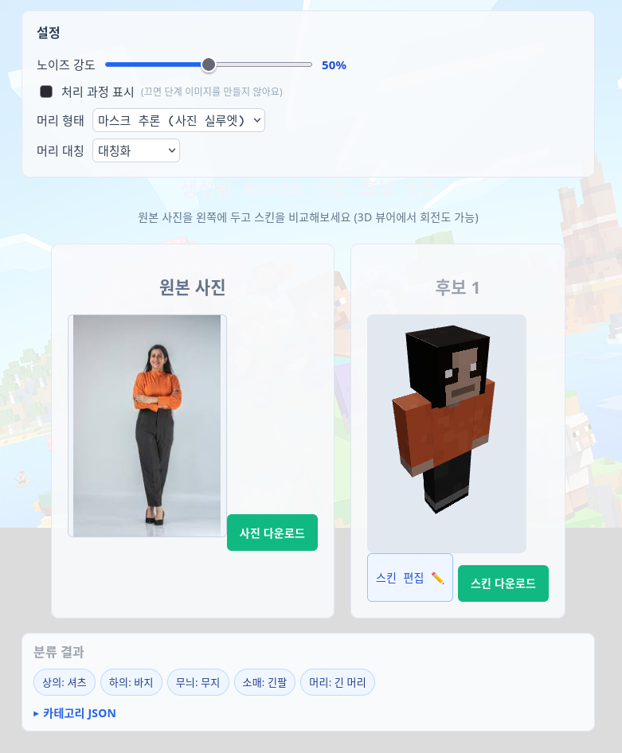

# skinmaker

인물 사진 → Minecraft 64×64 스킨 (RGBA PNG).

AI(VLM)는 사진에서 속성 JSON만 뽑습니다. 무엇을 입었는지(분류)와 무슨 색인지(색 추출)까지입니다. 픽셀은 전부 코드가 그립니다. 64×64 스킨에서 레이어당 칠할 수 있는 픽셀은 1,632개뿐이고 얼굴 앞면은 64픽셀입니다. 신경망 이미지를 옷칸(8×12)에 줄이면 색 얼룩이 되므로 AI의 몫을 분류와 색으로 제한했고, 렌더러가 하나뿐이라 이음새는 구조적으로 생기지 않습니다.




한 사진의 처리 과정입니다. S0 입력 게이트 → S1b SCHP 파싱 마스크 → S1 관측 색 → S3 64×64 아틀라스.

## 파이프라인

- S0 입력 게이트 (`quality.py`): YuNet 얼굴 검출과 품질 신호(밝기·흐림·크기). 유일한 거부는 얼굴 없음.
- S1 색 관측 (`colors.py`): 스킨 기준 화이트밸런스, 클러스터 대표색, 하의 캐스케이드.
- S1b SCHP 파싱 (`parsing.py`): 인체 파싱 마스크로 하의·머리·신발 색 위치를 확정. 기본 켜짐, 모델이 없으면 밴드 경로로 폴백.
- S2 분류 (`s2.py`): VLM이 5필드(상·하의 enum, 소매 길이, 무늬, 기장)를 채웁니다. 이중 질의가 어긋나면 불확실성으로 표시.
- S3 렌더 (`render.py`): 파라메트릭 텍스처, 하의 폴백 정책, 결정적 노이즈 시드.
- S4 후보 (`candidates.py`): 어긋난 필드만 변형해 1~3개 생성. 랭킹 없이 전부 검증을 통과해야 합니다.
- 웹: FastAPI + React 19 + three.js.

전송 계층(`vlm/`)은 mock, gemini, ollama, openrouter를 지원합니다.

## 설치 / 실행

```bash
python3 -m venv .venv
.venv/bin/pip install -r requirements.txt

.venv/bin/python -m pytest -q                   # 테스트 482개
.venv/bin/python -m skinmaker --model classic   # 더미 스킨 + 프리뷰 → out/
```

`python`이나 `uv`가 아니라 `.venv/bin/python`을 씁니다. 모델은 classic(팔 4px)과 slim(팔 3px)입니다.

얼굴 검출 모델(YuNet)은 커밋하지 않으므로 한 번 받아둡니다.

```bash
mkdir -p assets
curl -sSLf -o assets/face_detection_yunet_2023mar.onnx \
  https://github.com/opencv/opencv_zoo/raw/main/models/face_detection_yunet/face_detection_yunet_2023mar.onnx
```

## SCHP 파싱 (기본 켜짐)

```bash
.venv/bin/pip install -r requirements-parsing.txt   # onnxruntime (torch 불필요)
mkdir -p out/models
curl -sSLf -o out/models/schp-atr-18-int8-static.onnx \
  "https://huggingface.co/pirocheto/schp-atr-18/resolve/main/onnx/schp-atr-18-int8-static.onnx?download=true"
export SKINMAKER_PARSING=0   # 끄기 (밴드 전용으로)
export SKINMAKER_PARSER=out/models/schp-atr-18-int8-static.onnx   # 경로 지정
```

마스크가 있으면 Pants/Skirt 픽셀의 대표색이 하의 색이 되고, 머리·신발 색도 마스크에서 뽑습니다. 파일이나 의존성이 없으면 조용히 밴드 경로로 폴백합니다.

## 웹 (FastAPI + Vite)

```bash
set -a; source .env; set +a
.venv/bin/python -m uvicorn backend.app:app --host 0.0.0.0 --port 8001
cd frontend && npm install && npm run dev    # http://localhost:5173/
```

Vite 프록시가 8001을 바라보므로 포트를 바꾸면 `frontend/vite.config.js`도 고칩니다. `POST /api/v1/generate-skin`에 사진을 올리면 원본 옆에 후보 스킨을 3D 뷰어로 보여주고, 스킨 편집(투톤 신발), 분류 카테고리, 처리 과정 시트를 제공합니다.

## 설계 메모

- UV 레이아웃은 `skinmaker/format.py`가 단일 진실 소스이며 위키 수치와 자체 검증합니다.
- 좌/우 팔·다리는 `canvas.put()`이 작성자 좌표를 받아 쓸 때 뒤집으므로, 같은 코드로 그리면 좌우 대칭이 자동으로 맞습니다.
- `validate.py`가 크기(64×64), RGBA, 면 겹침, 블리드, 내부 레이어 불투명, 좌우 대칭을 검사합니다. Java는 오버레이 레이어에만 부분 투명을 허용합니다.
- Java Edition 스킨은 서명이 필요해 실제 게임에는 minecraft.net 업로드가 필요합니다. 빠른 확인은 PNG를 Bedrock에 복사하면 됩니다.

## CLI

```bash
.venv/bin/python -m skinmaker.samples <photo|folder>   # 단계별 컨택트 시트
.venv/bin/python -m skinmaker.measure <photos>         # S0 품질 분포
.venv/bin/python -m skinmaker.s2 --transport mock --photo <photo>
.venv/bin/python -m skinmaker.s4 --transport mock --photo <photo> --out out/s4
.venv/bin/python -m skinmaker.eval out/s0_photos --show 200
.venv/bin/python -m skinmaker.bottom_eval
```

## 상태

S0~S4와 웹까지 동작합니다. 테스트 482개 통과. 개발 규범은 TDD(빨강 먼저), 프론트 커밋 전 npm run lint, 정책 변경은 A/B 근거 필수.

타인 사진에는 초상권 동의가 필요하며, 이 도구는 로컬 전용입니다.
